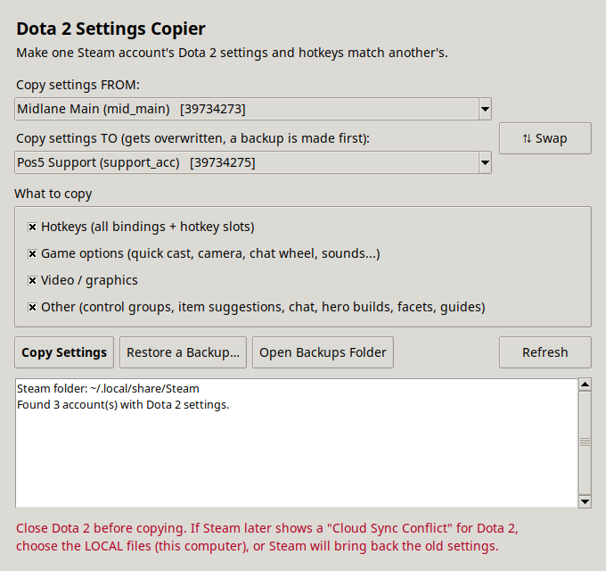
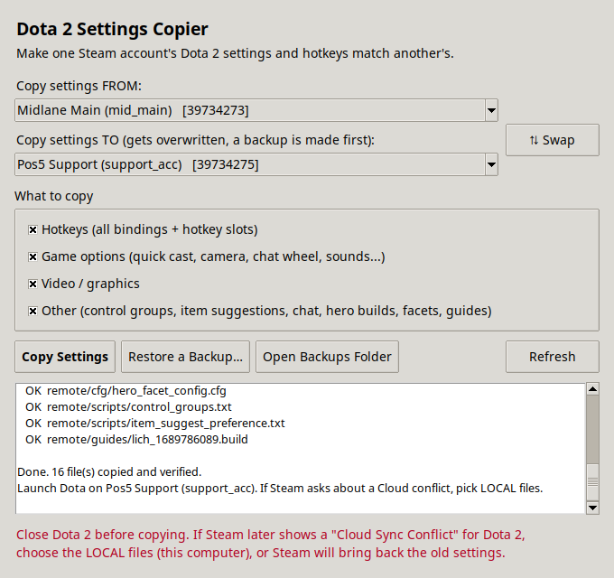
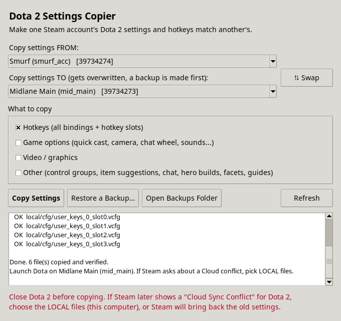

# Dota 2 Settings Copier

Make one Steam account's Dota 2 settings **and hotkeys** match another's on Windows, Linux (Ubuntu) and macOS.

Got a smurf, a second account, or a friend's account on your PC that has totally different binds? Pick the account you like, pick the one you want to change, click **Copy Settings**. Done.



## Features

- **Finds your accounts automatically.** Every Steam account on the computer that has played Dota 2 is listed by name.
- **Copies everything that matters:**
  - **Hotkeys:** all bindings and all 4 hotkey slots
  - **Game options:** quick cast, camera speed, chat wheel phrases, sounds, and every other option
  - **Video / graphics:** resolution, quality and other display settings
  - **Other:** control groups, item suggestions, chat settings, hero builds, facets and guides
- **Choose what to copy.** Untick any group you want to leave alone.
- **Always backs up first.** The account being overwritten is saved to `Documents/DotaSettingsBackups`, and **Restore a Backup…** undoes a copy.
- **Verifies every file** after copying it.
- **Leaves private data alone,** such as match stats, friends, guild data and voice bans.
- **Stops if Dota 2 is running,** since Dota would otherwise overwrite the copied settings when it closes.

| Copy everything | Copy only hotkeys |
| --- | --- |
|  |  |

## Download

Get it from the [**download page**](https://dota-settings-copier.vercel.app) or the [**Releases**](../../releases) page:

| System | File | How to run |
| --- | --- | --- |
| Windows | `DotaSettingsCopier-windows.zip` | Unzip and double-click `DotaSettingsCopier.exe`. If SmartScreen appears, click **More info → Run anyway**. |
| Linux | `DotaSettingsCopier-linux.tar.gz` | `tar -xzf DotaSettingsCopier-linux.tar.gz && ./DotaSettingsCopier` |
| macOS | `DotaSettingsCopier-macos.zip` | Unzip, then **right-click → Open** the app the first time (it isn't signed by Apple). |

## Run from source

It's a single Python file with no dependencies other than Tk.

```bash
# Ubuntu / Debian
sudo apt install python3-tk
python3 dota_settings_copier.py

# macOS (Homebrew)
brew install python-tk
python3 dota_settings_copier.py

# Windows (python.org installer includes Tk)
py dota_settings_copier.py
```

Options:

```
--steam-path PATH   Steam install folder (auto-detected if omitted)
--backup-dir PATH   Where backups go (default: Documents/DotaSettingsBackups)
```

## How to use

1. Make sure each account has launched Dota 2 at least once on this computer.
2. **Close Dota 2** (Steam can stay open).
3. Open the app, pick **FROM** (the settings you like) and **TO** (the account to change).
4. Click **Copy Settings**.
5. Log into the TO account and launch Dota 2.

> **Steam Cloud:** if Steam shows a **"Cloud Sync Conflict"** for Dota 2, choose the **local** files (the ones on this computer). Otherwise Steam brings back the old settings.

## Where Steam is looked for

| System | Locations |
| --- | --- |
| Windows | Registry (`HKCU\Software\Valve\Steam`), then `Program Files (x86)\Steam` |
| Linux | `~/.local/share/Steam`, `~/.steam/steam`, Flatpak and Snap Steam folders |
| macOS | `~/Library/Application Support/Steam` |

You can also set the `STEAM_PATH` environment variable or pass `--steam-path`.

Settings live in `Steam/userdata/<account id>/570/` (570 is Dota 2's app ID).

## Development

```bash
python3 -m unittest discover -s tests -v
```

GitHub Actions runs the tests and builds the Windows, Linux and macOS apps on every push. Pushing a `v*` tag publishes them as a release:

```bash
git tag v1.0.0 && git push origin v1.0.0
```

### Website

The download page at <https://dota-settings-copier.vercel.app> lives in `site/`. Vercel redeploys it on every push to `main`, using the settings in `vercel.json`. Each deploy copies the screenshots from `docs/screenshots`, so updating them there updates both the README and the site.

Preview it locally:

```bash
mkdir -p site/screenshots && cp docs/screenshots/*.png site/screenshots/
python3 -m http.server -d site 8000
```
